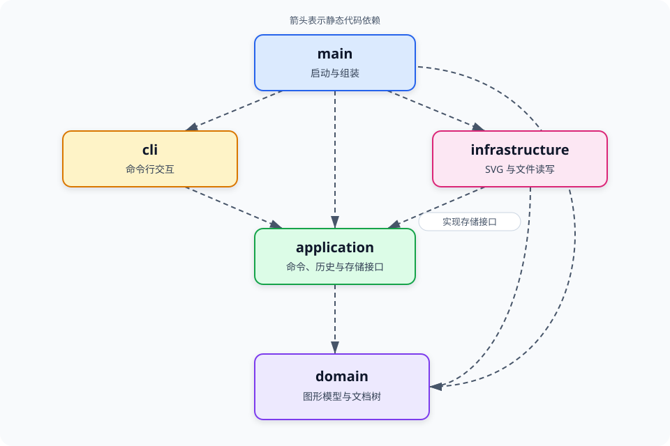
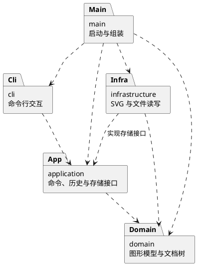

# Lab1 Phase 1：SVG 命令行编辑器项目文档

- **文档版本：** 1.0
- **编写日期：** 2026-10-29
- **当前状态：** 领域模型、应用命令、CLI 与 SVG 基础设施完成，最终集成验收待完成
- **需求依据：** 用户提供的 `phase_cli_1.md`，重点对应“提交内容／文档”、实现范式及命令与显示约定。

本文是项目 `doc/README.md` 的设计与过程文档。当前仓库已完成 TypeScript 工程骨架、领域模型、应用命令、CLI 交互层与 SVG 基础设施，架构方案继续作为最终集成验收的约束基线。

## 1. 架构方案

本节完成模块划分、设计模式选择、依赖方向规则和变化点假设。五层目录和启动依赖已由工程骨架初步验证；领域类、命令接口、快照恢复与历史策略已由代码和测试验证。原需求未完整定义的行为单独标为设计假设或待确认项。

### 1. 模块划分

#### 1.1 设计目标与阶段范围

本阶段实现一个使用 TypeScript、采用面向对象方式组织的 SVG 命令行编辑器。用户通过 `svg>` 提示符逐行输入命令，程序维护当前文档，执行图形编辑、结构查询、撤销重做及 SVG 文件读写。

实现范围包括以下能力：

- 六种内置图形：`rect`、`circle`、`ellipse`、`line`、`text`、`g`。
- 文档命令：`init`、`read`、`save`、`canvas`。
- 编辑命令：`create`、`delete`、`move`、`scale`、`set`、`group`、`ungroup`、`addto`、`front`、`back`。
- 显示命令：`tree`、`show`、`help`。
- 历史命令：`undo`、`redo`。
- 全文档唯一且大小写敏感的 ID、嵌套容器、创建时的 `in` 子句、统一错误输出，以及失败操作不改变状态。

`box` 及其插件注册、内部部件模板、专用属性传播和插件读回恢复属于后续阶段。本阶段对 `create box` 返回未知图形类型错误。当前工作围绕 CLI 展开，保存结果使用浏览器预览。

架构优先保证三件事：图形行为由封装的对象承担；一条编辑命令形成一个完整的撤销单元；输入输出与图形规则相互分离。

#### 1.2 五个模块及职责

| 模块目录 | 核心职责 | 代表性类或接口 | 职责边界 |
| --- | --- | --- | --- |
| `src/domain/` | 图形的几何与样式行为、文档树、父子关系、全局 ID 约束、类型构造、状态复制与恢复 | `Shape`、`Rect`、`Circle`、`Ellipse`、`Line`、`TextShape`、`Group`、`SvgDocument`、`ShapeFactory`、`DocumentSnapshot` | 不处理终端输入、文件路径、文件系统或具体 XML 库 |
| `src/application/` | 当前文档会话、命令执行流程、撤销重做、文档操作流程、查询结果和存储接口 | `EditorSession`、`Command`、`UndoableCommand`、`EditCommand`、`MoveCommand`、`GroupCommand`、`HistoryManager`、`SvgRepository` | 不依赖 CLI 语法实现、终端输出或具体文件读写类 |
| `src/cli/` | REPL、分词、命令参数解析与构造、帮助文本、树和属性的终端格式化、错误输出 | `Repl`、`Tokenizer`、`CommandFactory`、各命令的解析对象、`TreeFormatter`、`ShowFormatter` | 通过应用层执行操作，不直接修改图形内部字段 |
| `src/infrastructure/` | 文件系统访问、SVG XML 解析与编码、读写错误转换，实现应用层的存储接口 | `FileSvgRepository`、`SvgCodec` | 不决定撤销策略，不参与交互流程，不独立维护另一套图形模型 |
| `src/main/` | 创建具体对象、注入依赖、连接各模块、启动 CLI | `Main` | 只负责组装与启动，不集中实现编辑逻辑 |

上述名称为实现基线。所有类遵守“一类一文件，文件名与类名一致”的约定；接口和边界数据类型按职责单独组织。图形字段采用封装访问，外部通过方法执行操作，避免把模型变成任意可写的公共数据集合。

#### 1.3 领域模型与状态归属

##### 1.3.1 图形行为由具体类实现

`Shape` 定义统一的图形能力，例如移动、缩放、属性设置、描述信息提取及深复制。各具体类负责自身的参数约束和行为：

- `Rect` 维护 `x/y/width/height`。
- `Circle` 维护 `cx/cy/r`。
- `Ellipse` 维护 `cx/cy/rx/ry`。
- `Line` 维护两个端点。
- `TextShape` 维护位置和文本内容。
- `Group` 维护有序子节点和组自身的公共样式，并协调组合操作。

属性设置由公共样式规则和具体类型的属性白名单共同约束。图形位置、尺寸等数值变化通过对象方法完成，命令层不重复实现每一种图形的几何算法。

##### 1.3.2 文档统一维护结构不变量

`SvgDocument` 负责当前画布与整棵图形树，并提供统一的结构操作入口。需要维护的不变量包括：

1. 图形和 `g` 的 ID 在全文档内唯一、大小写敏感；根 `<svg>` 由文档对象表示，不额外占用一个普通图形 ID。
2. 每个图形至多属于一个父容器；根级图形的父级是文档根，嵌套图形的父级是 `Group`。
3. 父节点关系、子节点列表与 ID 索引相互一致。
4. 子节点顺序具有语义，影响显示前后关系以及结构编辑后的恢复。
5. 容器不能成为自身或自身后代的子节点，图形结构必须保持为树。
6. 删除容器时，其全部后代从树和 ID 索引中一并移除。

结构操作通过文档与容器的受控方法完成。应用层、CLI 和文件读写模块不另建各自独立的可变 ID 索引，也不直接修改内部数组。图形描述和查询结果对外只读。

##### 1.3.3 文档状态与会话状态分开管理

`SvgDocument` 保存画布和图形内容；`EditorSession` 管理当前文档、相关文件路径及会话操作；`HistoryManager` 管理编辑历史和文档操作后的历史限制。

文件路径不属于图形本身。普通编辑命令只修改文档内容，不能顺便改变默认保存路径。所有影响历史或会话状态的变更都应在对应操作成功后提交。

#### 1.4 模块包图

下图是模块包图的可直接预览版本，箭头表示静态代码依赖，而不是运行时数据流。PlantUML 源文件见 [architecture.puml](architecture.puml)。

对应的 PlantUML 源码如下：

`infrastructure → application` 主要表示具体存储实现依赖并实现应用层定义的接口。应用层在运行时可以调用该实现，但静态代码仍面向接口，不反向导入基础设施类。

#### 1.5 典型操作的职责分配

##### 编辑：`move r1 30 0`

1. `Repl` 读取输入，`Tokenizer` 处理空白、引号及整行注释。
2. `CommandFactory` 根据命令名选择解析对象，生成参数已结构化的 `MoveCommand`。
3. 应用层执行命令；编辑命令经 `HistoryManager` 调度。
4. `MoveCommand` 按 ID 从当前文档获取目标，调用目标的多态移动能力。
5. 操作成功后记录历史，返回结构化结果，由 CLI 格式化并输出摘要。

##### 导入：`read example.svg`

1. 应用层通过 `SvgRepository` 接口请求加载。
2. `FileSvgRepository` 读取文件，`SvgCodec` 解析 XML。
3. XML 层提供节点信息，图形类型构造统一复用 `ShapeFactory`。
4. 在临时文档中完成层级构建、缺失 ID 分配及唯一性验证。
5. 全部成功后，应用层替换当前文档、更新相关会话状态，并设置文档操作后的历史限制。
6. CLI 输出结果及本次成功导入产生的警告。

导入失败时不替换当前文档，不改变当前路径或历史状态。自动补 ID 应避开整个输入文档中的显式 ID，包括尚未遍历到的节点 ID。

### 2. 设计模式的选择

#### 2.1 选型总览

| 模式或机制 | 采用原因 | 计划中的落地位置 | 与作业要求的关系 |
| --- | --- | --- | --- |
| Command | 把操作行为封装为对象，统一执行与撤销重做 | 应用层命令类和 `HistoryManager` | 作业明确要求 |
| Composite | 对叶子和容器使用统一的图形操作 | `Shape`、具体图形类、`Group` | 满足作业明确规定的组合语义 |
| Memento／文档快照 | 准确恢复复杂结构编辑前后的完整状态 | `DocumentSnapshot`、`SvgDocument`、`EditCommand` | 本方案对撤销实现方式的选择 |
| 集中式工厂 | 统一两类按名称构造实现的入口 | `CommandFactory`、`ShapeFactory` | 对应作业允许的两处分派位置；须标为待重构点 |

这些模式分别解决操作封装、树结构统一操作、状态恢复和类型构造问题。当前不额外引入没有明确职责的插件框架或事件总线。

#### 2.2 Command：编辑操作与历史调度分离

##### 2.2.1 职责分工

- `Command` 表达可执行的应用操作；具体命令负责自己的语义。
- `UndoableCommand` 表达可执行、撤销和重做的编辑能力。
- `EditCommand` 作为编辑命令的公共基类，负责编辑前后快照、失败恢复及撤销重做的公共流程。
- `MoveCommand`、`SetCommand`、`GroupCommand` 等实现具体编辑动作，使用领域模型提供的能力。
- `HistoryManager` 维护 undo/redo 栈，只依赖可撤销命令接口，不导入所有具体编辑命令。

命令按行为分为编辑、查询、文档操作和历史控制。各类命令通过接口和多态表达不同的执行及历史策略；应用层不得再次按 `move`、`save` 等命令名选择实现。只有编辑命令进入编辑历史，查询和历史控制本身不作为新的编辑项。

##### 2.2.2 历史规则

1. 一条成功编辑命令形成一个撤销单元。即使 `group` 一次处理多个对象，也只增加一个历史项。
2. 编辑命令成功后才进入 undo 栈。成功的新编辑会清空 redo 栈；文档操作成功后的历史重置按第 4.3 节处理。失败编辑和查询命令不清空 redo 栈。
3. 失败编辑不增加历史项，不清空 redo 栈，也不解除尚未解除的文档操作限制。
4. `undo` 或 `redo` 在状态恢复成功后，才将相应命令移动到另一栈。
5. `tree/show/help` 不改变编辑历史；无参数 `canvas` 作为尺寸查询处理。
6. 成功执行 `init/read/save` 或修改画布尺寸后，按作业要求暂时禁止 undo/redo，直到下一条成功编辑。

“文档操作后是否清空旧历史”属于原文未完整规定的部分。本方案的初版策略见第 4.3 节，不把该选择表述为课程原有规定。

#### 2.3 Composite：叶子和分组统一操作

调用者通过 `Shape` 的统一能力操作对象，不在每个命令里重复判断矩形、圆、线段或分组。

| 操作 | 普通图形的行为 | `Group` 的行为 |
| --- | --- | --- |
| `move` | 更新自身位置；线段更新两个端点 | 遍历直接子节点并调用其 `move`，由子组继续递归 |
| `scale` | 按要求将位置与尺寸等几何属性乘以因子 | 遍历直接子节点并调用其 `scale`，每个后代只处理一次 |
| `set` | 验证公共样式及本类型属性白名单，再修改自身 | 修改组自身支持的公共样式；不接受不存在的几何属性 |
| `delete` | 从文档删除该节点 | 文档删除整个子树，并同步移除全部相关 ID |
| 描述与复制 | 提供自身数据的只读描述及深复制能力 | 在自身信息基础上递归处理有序子节点 |

组的平移和缩放采用递归修改支持的几何数值的方式，使 `tree/show` 中的值与作业规定一致。避免同时遍历“全部后代”又让子组递归，以免重复变换。

对普通 `g` 执行 `set fill/stroke/stroke-width`，设计为修改组自身的公共样式，保留子节点显式设置的属性；不套用后续 `box` 插件的强制转发规则。`g` 不具有 `x/y/width/height` 等几何属性，对这些属性的设置应按白名单规则拒绝。

“能否接收子节点”通过容器能力接口或多态方法表达，不在各命令中分散比较类型字符串。根级 `g` 禁止 `ungroup`、分组不能包含自身及后代冲突等结构约束由领域层统一执行。

#### 2.4 Memento：采用全量文档快照完成撤销恢复

##### 2.4.1 唯一的恢复协议

本阶段采用全量文档快照：编辑命令的公共实现保存执行前的 `before` 快照和执行后的 `after` 快照；`undo` 恢复 `before`，`redo` 恢复 `after`。

职责固定为：**Command 表达编辑行为，HistoryManager 保存和调度命令，DocumentSnapshot 保存状态，SvgDocument 负责恢复状态。** 不再为每一种结构命令另建一套反向重放协议。

直接恢复 `after` 快照可以保证重做还原的是当时成功执行后的状态，不必重新触发创建、验证或其他操作流程。所有普通编辑命令都使用相同恢复机制。

##### 2.4.2 快照内容

快照覆盖当前支持范围内的完整文档内容：

- 画布尺寸及支持的根级文档属性。
- 有序的图形树，包括全部图形和容器的 ID。
- 各图形的几何属性、文本内容和样式。
- 可选属性是否存在，区分“未设置”和“显式设置为某值”。
- 完整的层级关系与同级顺序。
- 若存在持久的自动 ID 计数器，保存其状态或以确定性规则重建。

父节点引用与 ID 索引可以根据恢复后的树重新建立，不需要把循环引用直接序列化。默认文件路径和历史栈由会话与历史管理器负责，普通编辑不修改这些状态。

##### 2.4.3 复制与恢复要求

`DocumentSnapshot` 封装其内部状态，外部不能直接修改。快照通过图形对象的多态深复制协议创建和恢复；`Group` 递归调用子节点的复制能力，不再按图形类型名选择实现。

快照与当前文档不得共享可变节点或可变属性集合。恢复完成后，后续命令重新通过 ID 查找当前对象，不依赖旧的 `Shape` 引用。这样可以避免快照被后续编辑污染，以及恢复后继续修改已经脱离当前文档的对象。

##### 2.4.4 取舍

全量快照便于准确恢复 `group/ungroup/delete/addto/front/back` 等复杂结构变化，也避免依靠反复乘除恢复缩放时产生累计误差。代价是历史内存占用随文档规模和历史长度增加。

本阶段暂按小型交互文档设计，优先保证恢复逻辑完整、集中且易核对。后续出现明确的内存或性能问题时，再在相同的撤销接口下引入局部快照、差量记录或历史长度限制。

#### 2.5 集中式工厂：仅保留两个按名称分派入口

| 入口 | 允许的分派 | 其他模块的使用方式 | 当前状态 |
| --- | --- | --- | --- |
| `cli/CommandFactory.ts` | 命令名 → 命令解析／构造实现 | REPL 分词后将请求交给工厂；执行层使用命令接口 | 本阶段允许，标为待重构 |
| `domain/ShapeFactory.ts` | 图形类型名 → 图形构造实现 | `create` 和 SVG 导入共享同一套类型映射 | 本阶段允许，标为待重构 |

`ShapeFactory` 管理六种内置类型的构造信息。各类型特有的创建参数解释由对应的类型构造实现承担，CLI 通过应用层获得所需的构造描述；`CreateCommand` 不再另写一套按类型名处理位置参数的分支。CLI 只通用处理 ID、尾部 `in` 子句等公共语法。

以下位置不得新增按命令名或图形类型名选择实现的分派表、`switch` 或 `if/else` 链：

- `Tokenizer`、应用层总控制器和历史管理器。
- SVG 导入中的图形实例化逻辑。
- SVG 导出、`tree/show` 输出逻辑。
- 平移、缩放、属性验证和快照复制恢复逻辑。

SVG 导出使用图形提供的中立节点描述，XML 库负责编码与转义；`tree/show` 使用图形提供的只读描述进行通用格式化。描述对象仅用于跨模块传递数据，核心模型仍是封装了字段和行为的类。

当前两个工厂集中管理内置映射。后续插件化时可改为显式注册机制；本阶段不提前实现插件发现、动态加载和生命周期管理。

#### 2.6 错误原子性与命令流程

“命令失败不改变任何状态”同时约束图形内容、ID 索引、会话状态与编辑历史。

编辑命令采用以下顺序：

1. 完整校验参数、目标 ID、容器能力、属性白名单和结构约束。
2. 准备执行前快照。
3. 在受控的领域操作中完成修改。
4. 成功创建执行后快照，再提交历史变化和成功结果。
5. 若修改或执行后快照创建失败，则恢复执行前状态；历史栈和会话状态保持原样。

例如，`group` 必须先验证所有目标，再开始摘取节点；`addto` 必须先验证目标容器以及成环风险。失败编辑既不能占用新 ID，也不能清除原有 redo 分支。

文档读取在临时文档中完成。保存由存储实现保证错误可报告，并优先使用临时文件写入后替换目标的方式降低部分写入风险；保存成功后，应用层才提交相关路径决策和历史限制。输出由 CLI 在操作结果确定后统一格式化，避免模型或命令在中途直接打印成功消息。

### 3. 依赖方向规则

#### 3.1 允许的模块依赖

矩阵中行是导入方，列是被导入方。`允许` 表示可以依赖该模块的公开契约，不表示可以访问其任意内部实现。

| 导入方／被导入方 | `domain` | `application` | `cli` | `infrastructure` | `main` |
| --- | --- | --- | --- | --- | --- |
| `domain` | 模块内部 | 禁止 | 禁止 | 禁止 | 禁止 |
| `application` | 允许 | 模块内部 | 禁止 | 禁止 | 禁止 |
| `cli` | 禁止直接依赖 | 允许 | 模块内部 | 禁止 | 禁止 |
| `infrastructure` | 允许 | 仅存储接口及必要的边界契约 | 禁止 | 模块内部 | 禁止 |
| `main` | 允许 | 允许 | 允许 | 允许 | 模块内部 |

CLI 所需的查询结果、命令输入和创建参数描述由应用层边界提供。基础设施可以使用领域对象和图形工厂，但不能依赖应用层内部的历史策略或具体编辑命令。

#### 3.2 各条规则的理由

**规则 D1：领域层保持独立。**
`domain` 只表达图形与文档规则，不依赖其他业务模块，不读写终端和文件，不导入具体 XML 库。这样几何操作、结构约束和快照机制可以独立使用与验证。

**规则 D2：应用层面向模型与存储接口。**
`application` 使用 `domain`，并在自身定义 `SvgRepository` 等必要接口。它不导入 `FileSvgRepository` 或 `SvgCodec` 等具体实现，因此替换文件存储或解析库不需要改变编辑命令。

**规则 D3：CLI 是交互适配层。**
`cli` 负责把终端输入转换成应用操作，并格式化应用结果。它不持有可任意修改的图形内部状态，也不绕过应用层直接读写文件。

**规则 D4：基础设施实现边界契约。**
`infrastructure` 可以依赖 `domain` 以及 `application` 中的存储接口和返回值契约，用于加载和保存文档；不负责决定何时清空历史、如何执行编辑或向用户显示哪些交互提示。

**规则 D5：启动入口集中组装。**
`main` 创建文档服务、工厂、历史管理器、存储实现及 CLI，并注入依赖。它可以依赖所有模块，但不承担具体编辑行为。其他模块不导入启动入口。

#### 3.3 模块内部的防循环规则

- `Shape` 等抽象不导入全部具体图形；具体图形依赖抽象，`ShapeFactory` 负责集中构造。
- `HistoryManager` 只依赖 `UndoableCommand` 及必要的文档接口，不导入每个具体命令类。
- 具体命令通过 `CommandContext` 等应用契约取得当前文档与所需服务，避免具体命令与会话总控制器相互导入。
- `EditorSession` 不导入 CLI 中的 `CommandFactory`。
- 应用层存储接口不引用某个 XML 库的节点类型；文件与 XML 实现细节止于基础设施边界。

#### 3.4 跨模块数据与错误传递

跨模块使用明确的输入、结果和只读描述对象。它们可以承载数据，但不能替代承担业务行为的图形类和命令类。

- CLI 向应用层传递结构化参数，不让领域模型自行解析整行终端文本。
- 应用层向 CLI 返回结构化结果、查询描述或错误信息，CLI 负责统一的 `error:`、warning 和成功摘要格式。
- SVG 节点描述与查询描述不包含具体 XML 库对象、终端句柄或可随意修改的内部节点引用。
- 文档不存在、ID 冲突、容器非法等错误由负责相应约束的层产生，再由应用边界转换为可显示的结果。

错误文案以作业明确给出的约定为准；原文未规定的错误采用统一风格，并在实现时集中维护。

#### 3.5 依赖偏差的处理原则

如果实现中需要增加当前规则禁止的依赖，先检查是否可以通过已有接口、职责调整或必要的新边界契约解决。确需改变架构时，应先说明原因，再同步修订模块图、依赖矩阵和相关设计说明。

违反规则且没有完成修订的依赖属于待处理项，不能仅因代码能够运行就视为合理。此处定义检查依据，不预先宣称最终代码已经符合这些规则。

### 4. 变化点假设

#### 4.1 预计变化与当前准备

以下假设基于本阶段的功能范围和原文明确提到的后续插件化方向。预留优先放在已存在的职责边界，不为所有想象中的需求提前增加实现。

| 变化点 | 为什么可能变化 | 当前预留 | 当前不实现的内容及理由 |
| --- | --- | --- | --- |
| 新增图形类型 | 后续阶段明确提出 `box`；其他几何类型也可能增加 | `Shape` 统一行为，`ShapeFactory` 集中管理构造；类型参数由相应构造实现解释 | 当前只有六种内置类型，不提前实现全部 SVG 标签 |
| 新增或调整命令 | 编辑能力、参数和交互方式可能扩展 | Command 对象与历史管理分离，命令构造集中于 `CommandFactory` | 不建立通用脚本语言、复杂语法树或动态命令加载系统 |
| 引入图形插件 | `box` 需要部件模板、专用属性语义和读回识别 | 保持组合操作统一，标出工厂待重构点，隔离类型构造与通用编辑流程 | 不提前实现插件发现、生命周期、版本兼容或 `ShapeProvider` 的完整协议，避免在需求尚未落地时过度抽象 |
| 增加 GUI 或其他入口 | 同一图形编辑能力可能通过鼠标或其他通道使用 | CLI 只负责输入输出，应用命令和领域行为独立 | 当前不实现 GUI、自然语言运行接口或网络服务 |
| 更换 XML 库或文件存储 | 解析能力、部署环境或存储介质可能变化 | `SvgRepository` 隔离存储，`SvgCodec` 隔离 XML 实现 | 不为尚未提出的所有文件格式和远程存储建立适配器 |
| 扩大 SVG 导入范围 | 外部文件可能带更多标签、属性或变换 | 单独维护导入支持范围，XML 处理与图形构造分离 | 不默认为完整 SVG 实现；复杂变换、样式表、引用及其他特性需明确需求后扩展 |
| 历史占用过多内存 | 图形数量或编辑次数增长后，全量快照成本增加 | 快照与历史调度集中管理，编辑命令通过统一恢复接口工作 | 当前不做增量历史或快照压缩；出现实际容量要求后再替换内部策略 |
| 输出格式调整 | `tree/show` 的显示布局或错误呈现可能变化 | 独立的终端格式化对象和结构化结果 | 不在领域模型中写死终端排版或颜色控制 |

#### 4.2 两个明确的待重构点

##### R1：命令构造映射

本阶段 `CommandFactory` 集中维护命令名到构造实现的映射。新增命令仍可能需要修改该映射，这是当前接受的扩展成本。

当命令需要由独立模块或插件提供时，再将固定映射调整为显式注册机制，保持应用层命令执行接口和历史规则稳定。

##### R2：图形构造映射

本阶段 `ShapeFactory` 集中维护六种内置类型的构造信息，`create` 与 SVG 导入复用该入口。新增类型需要增加类实现并更新映射，当前尚不承诺后续插件所要求的“内核新增代码为 0”。

进入插件化阶段后，再根据实际需求建立类型注册、参数 schema、复合部件创建、属性传播及序列化恢复协议。该重构应保持普通编辑命令通过 `Shape` 统一操作的原则。

#### 4.3 原文未完整定义的行为与初版决策

下表区分课程已经明确的要求与本方案需要补足的语义。待确认项在相关功能定稿前与课程规范对齐，其余模块可继续按既定设计开发。

| 问题 | 原文已经明确的部分 | 本方案初版决策／待确认项 |
| --- | --- | --- |
| 文档操作后的历史 | `init/read/save` 与修改尺寸的 `canvas` 后暂时禁用 undo/redo，下一次编辑重新解禁 | 初版采用：操作成功后清空两栈并设置禁用标记，下一条成功编辑建立新历史；这是本方案选择，需与评测口径确认 |
| 跨父容器 `group` | 允许从各自原父容器摘出对象，且需保持相对顺序 | 当前实现采用确定性规则：组挂到命令中第一个 ID 的原父级并占据该节点移除后的原位置，组内成员按分组前的文档先序排列；同时选择容器及其后代会在修改前被拒绝。该规则已有测试，仍需与评测口径确认 |
| 无参数 `save` | 可以保存到读入时的路径 | 已实现：新建且无路径时报错并要求文件名；成功 read 或显式 save 会成为后续无参 save 的目标，失败不改变原路径 |
| 外部 SVG 的支持范围 | 本阶段内置六种图形；要求读入、补 ID 和保存 | 已实现六种标签、嵌套组、根画布、规定几何与公共样式属性；未知元素或影响画面的未知属性明确拒绝，不静默丢弃 |
| 外部 `transform` | 背景示例展示该属性；编辑命令规定几何值的更新语义 | 已实现 `translate` 与等比 `scale` 的组合并在导入时归一化到几何值；rotate、matrix、skew 和非等比 scale 明确拒绝 |
| 输入文件已有重复 ID | 当前文档的 ID 必须唯一 | 已实现整次导入拒绝并保留原文档；自动 ID 会预扫描全部显式 ID，避免与尚未遍历到的节点冲突 |
| 未初始化时 `help` | 启动提示引导用户输入 help；未初始化错误规则的表述较宽 | 初版允许 help 在无文档时显示，其余依赖文档的操作按规定报错；需与课程口径对齐 |

普通 `g` 的样式处理按第 2.3 节采用标准组样式语义。若后续评测对传播行为给出更具体规则，再调整对应模型行为，并保留这一设计变更的理由。

#### 4.4 不随设计假设改变的明确约束

以下行为已经由作业规定，不作为可自由选择的实现策略：

- 使用 TypeScript 与面向对象方式，字段封装、一类一文件，实际采用 Command 模式。
- 容器与叶子支持统一操作，类型分派只集中在两个允许的入口。
- ID 全文档唯一且大小写敏感；CLI 的 `create/group` 显式给 ID，导入缺 ID 时自动补齐并警告。
- 缩放因子必须为正，缩放同时作用于支持的几何位置与尺寸；容器递归处理后代。
- `set` 按规定白名单处理，不能因为某个 SVG 属性本身合法就自动开放。
- 顶层 `g` 不允许 `ungroup`；嵌套容器解组后子节点提升到其父级并占据原位置。
- `#` 开头的注释行与十六进制颜色参数必须正确区分；双引号中的空格文本应完整保留。
- 未提供 `fill/stroke` 时不补写该属性，保留属性缺省的意义。
- 一条编辑命令对应一个撤销单元；成功的新编辑清空 redo；失败操作保持文档、历史和相关会话状态不变。
- `box` 属于后续阶段，本阶段不实现该类型。

本方案以这些明确约束为设计边界。后续实现如改变模块、接口或恢复策略，应同时更新相关章节，使设计说明继续对应最终代码。

## 2. 过程记录

### 2.1 2026-10-29：建立实现前架构基线

本轮先对照项目要求拆分交付范围，再形成架构基线。关键判断与修订如下：

1. **没有把 CLI、业务规则和 SVG 文件读写放进同一个控制器。** 最终划分为 `domain`、`application`、`cli`、`infrastructure`、`main` 五个模块，并明确静态依赖方向。
2. **Command 不等于只有命令分发。** 命令对象负责表达编辑行为，`HistoryManager` 只调度可撤销命令；复杂结构编辑统一使用文档快照恢复，避免每个命令维护一套容易失配的反向操作。
3. **避免按图形类型到处分支。** `move`、`scale`、`set`、复制和描述由图形对象多态实现；按名称分派只保留在命令工厂和图形工厂两处，并明确记录为后续待重构点。
4. **没有提前实现后续阶段的 `box` 插件系统。** 当前阶段只为六种内置图形设计稳定边界；插件注册、复合模板和属性传播留到真实需求出现时再扩展。
5. **把需求中的空白显式列为设计假设。** 文档操作后的历史处理、跨父容器分组、无参数保存、外部 SVG 支持范围、`transform`、重复 ID 和未初始化时的 `help` 均未伪装成已经明确的课程规则。
6. **强化失败原子性。** 编辑先完整校验，再修改并生成执行后快照；导入先构建临时文档，全部成功后才替换会话状态。失败不得污染文档、历史、路径或 ID 分配状态。

### 2.2 2026-10-29：建立 TypeScript 工程骨架

本轮按五层架构建立 `src/domain`、`src/application`、`src/cli`、`src/infrastructure` 和 `src/main`，并完成以下决策与修正：

1. `Main` 只创建并启动 `Repl`，终端循环保留在 CLI 层，没有把业务命令提前塞进启动入口。
2. domain、application、infrastructure 当前只提供模块边界，不伪造尚未实现的领域类或服务。
3. 启用 TypeScript 严格检查、ESLint、Vitest、独立构建配置和统一 LF 文本规则；编译产物与依赖目录不进入版本控制。
4. 最小 REPL 只负责 banner、提示符和明确的未实现提示，使源码入口与编译入口均可启动，同时避免提前定义真实命令语义。
5. pnpm 11 默认阻止依赖安装脚本。经确认 `esbuild` 是 `tsx/Vitest` 的构建依赖后，在 `pnpm-workspace.yaml` 中只允许该包执行构建脚本，没有全局放开权限。
6. 首轮类型检查发现通用 `Writable` 不包含 `isTTY` 声明；通过局部 `TerminalWritable` 边界类型修正，没有把输出流强制转换为具体终端类。

验证结果：类型检查、lint、2 个 REPL 测试和构建全部通过；源码入口 `pnpm run cli` 与编译入口 `pnpm start` 均完成冒烟测试。

### 2.3 2026-10-29：实现领域模型与文档树

本轮实现六种内置图形、`Group`、`ShapeFactory`、`SvgDocument` 和 `DocumentSnapshot`，关键取舍如下：

1. 几何变换、属性白名单与数值约束由具体图形对象承担；文档和调用方不按图形类型重复实现算法。
2. `Group` 递归委托直接子节点完成 move/scale，使嵌套后代只处理一次；组样式保留在组自身，不覆盖子节点显式样式。
3. `SvgDocument` 集中维护根节点顺序、全文档 ID 索引和父关系，提供添加、删除、重新挂载、前后排序与嵌套解组操作，并在修改前完成可预见校验。
4. 为防止外部绕过文档破坏索引，容器结构写操作使用未从领域公开入口导出的内部授权；公开的子节点集合是只读副本。
5. 快照在创建、读取和恢复时均深复制整棵树；恢复先构建临时文档并重建索引，成功后才替换当前状态。
6. 图形类型名的唯一分派位于 `ShapeFactory`；其他领域操作通过多态或容器能力完成。

验证结果：5 个测试文件共 26 个测试通过，其中领域测试覆盖六种图形、Composite 递归、属性规则、ID 唯一性、受控子节点集合、删除子树、重挂载、成环保护、z-order、ungroup、画布原子校验和快照隔离。

### 2.4 2026-10-29：实现应用命令与历史管理

本轮完成 Command 模式的实际落地，并把领域结构操作接入统一历史边界：

1. `EditCommand` 在执行前后保存完整文档快照；具体命令只表达编辑语义，undo/redo 统一恢复快照，不各自维护易失配的反向操作。
2. `HistoryManager` 只依赖 `UndoableCommand`，成功编辑才进入 undo 栈并清空 redo；失败编辑不改变两栈，基类还会恢复可能已经发生的局部修改。
3. `EditorSession` 统一处理无文档错误，以及 `init/read/save/canvas` 成功后的历史清空和锁定；只有下一条成功编辑解除锁定，失败编辑与失败尺寸校验均不改变锁状态。
4. 十种编辑命令均返回结构化结果，不直接输出终端文本，也不导入 CLI 或基础设施。应用层没有按命令名进行 `switch` 分派。
5. `SvgDocument.groupShapes` 负责分组的结构原子性。跨父容器分组采用第 4.3 节记录的确定性规则；空选择、重复成员、ID 冲突、缺失成员和祖先/后代同时选择均在摘除节点前拒绝。
6. 新增应用测试覆盖所有编辑动作、单步结构撤销、redo 分支、失败回滚、IO 历史锁和命令实例状态；加上领域分组测试后，当前共 7 个测试文件、37 个测试通过。

### 2.5 2026-10-29：实现 CLI 解析、格式化与 REPL 接线

本轮把终端输入接入已完成的应用命令，同时保持 CLI 只依赖 application 公共边界：

1. `Tokenizer` 支持任意空白、双引号文本、引号与反斜杠转义、空字符串；只有首个非空白字符为 `#` 时才视为注释，因此 `#4a90d9` 等颜色不会被截断。
2. `CommandFactory` 成为唯一的命令名分派位置，完成文档、编辑、显示、历史和文件命令的参数校验与对象构造。CLI 不直接导入 domain 或 infrastructure。
3. 为避免 CLI 再按图形类型分派，`CreateCommandBuilder` 通过应用边界调用 `ShapeFactory.createRequest`；六种内置类型的参数数量、数值转换及可选 fill/stroke 仍集中在图形工厂文件中。这是对原方案“通过构造描述解释参数”的简化落地，保持两处分派位置不变。
4. `TreeFormatter` 与 `ShowFormatter` 只消费只读描述对象，按属性名通用排序和显示，不按图形类型分支；结构树保留 Unicode 层级线并内联几何与样式属性。
5. REPL 逐行顺序等待异步命令，错误只影响当前行，后续命令继续执行。`help` 可在无文档时使用，其余依赖文档的命令由应用边界返回统一错误。
6. `read/save` 已通过 `DocumentOperationGateway` 完成 CLI 注入契约和输出格式测试；当前启动入口尚未注入具体实现，会明确报告文件支持未配置，下一阶段由应用文档服务和基础设施接管。

验证结果：当前 9 个测试文件共 45 个测试通过；真实 CLI 冒烟会话覆盖 init、嵌套创建、tree、show、move、undo、redo 与 canvas 查询。

### 2.6 2026-10-29：实现 SVG 编解码与文件基础设施

本轮完成 `read/save` 的真实文件路径，并把文件失败原子性落实到代码和测试：

1. application 新增 `SvgRepository` 和 `DocumentService`。仓储只负责加载/保存，服务在仓储成功后才替换文档、更新默认路径并设置历史锁；失败不会改变文档、路径或 undo/redo 状态。
2. `SvgCodec` 使用有序 XML 解析结果构建临时文档，复用 `ShapeFactory.createRequestFromAttributes` 构造六种图形；基础设施没有新增图形类型 `switch`。导入完整成功后，`DocumentService` 才提交到会话。
3. 导入前预扫描全部显式 ID，重复 ID 直接拒绝，自动 ID 会跳过后续才出现的显式 ID，并按文档顺序输出 warning。
4. 编码通过只读 `ShapeDescription` 通用递归，不按图形类型分支；文本与属性分别正确 XML 转义，缺省 fill/stroke 不会被补写。
5. 支持 `translate` 与等比 `scale` 组合，并按 SVG 变换顺序归一化到几何值。未支持元素、属性和变换明确报错；DOCTYPE 被拒绝，避免外部实体输入。
6. `FileSvgRepository` 在目标同目录写唯一临时文件，成功后重命名替换；读写系统错误转换为需求规定的稳定错误，失败时清理临时文件。
7. 启动入口现在注入 `DocumentService` 与 `FileSvgRepository`，真实 CLI 的 `read/save` 已可使用。

验证结果：当前 13 个测试文件共 57 个测试通过，覆盖编码往返、六种图形、嵌套组、缺失/重复 ID、转义、viewBox、px 尺寸、变换、未知内容、DOCTYPE、文件覆盖、读写错误和完整 `read → edit → save` 命令路径。

### 2.7 后续记录规则

代码实现阶段每次出现以下情况时，应在本节追加日期、问题、证据、决策和影响范围：

- 实际代码需要偏离本架构方案；
- AI 建议与需求原文、测试结果或 TypeScript 行为不一致；
- 待确认项获得明确结论；
- 发现新的跨模块依赖、分派点或状态恢复边界；
- 测试暴露出需求理解或设计假设错误。

过程记录只保留能解释设计演进的代表性事件，不把普通命令执行流水账写入文档。

## 3. 一致性自查

### 3.1 当前结论

当前仓库已完成工程骨架、领域模型、应用命令、CLI 与 SVG 基础设施。五层目录和依赖方向已经按实际 import 扫描；领域、应用、CLI、编解码和文件命令均有自动化测试，剩余工作是完整典型会话、浏览器预览和最终交付检查。

| 检查项 | 当前状态 | 代码完成后的验收方式 |
| --- | --- | --- |
| 模块划分 | 当前符合；五个目录均已落地，main 只组装具体仓储、服务和 CLI | 最终验收再次抽样 import |
| 一类一文件、字段封装 | 当前符合；`SvgCodec`、`FileSvgRepository` 与 `DocumentService` 职责独立 | 最终检查新增文件和公开状态 |
| Command 模式 | 已验证；编辑历史与文件命令边界均通过 CLI/集成测试 | 最终典型会话回归 |
| Composite 语义 | 已验证；叶子和嵌套 `g` 的 move/scale/set/delete 行为有测试覆盖 | 应用命令完成后补端到端验证 |
| 依赖方向 | 当前符合；infrastructure 仅依赖 domain 和 application 存储契约，CLI 不依赖 infrastructure，具体注入只在 main | 最终再次扫描所有 import |
| 两处分派限制 | 已验证；命令名分派仅位于 `CommandFactory`，图形类型分派仅位于 `ShapeFactory` | SVG 导入完成后确认没有新增图形类型分派 |
| 设计偏差记录 | 已记录创建参数描述的简化落地；没有扩大模块依赖 | 实现每个阶段结束时继续比较实际结构与本方案 |

### 3.2 实现完成后的抽样方法

1. 列出 `src/` 下的目录和文件，逐项映射到第 1 节的模块职责。
2. 搜索所有 TypeScript `import`，按第 1 节依赖矩阵检查方向；任何例外都必须说明原因并登记为待处理项。
3. 搜索命令名、图形类型名、`switch` 与长 `if/else`，检查是否产生第三处分派。
4. 从 `create → move → group → undo → redo → save → read` 选一条完整路径，核对 CLI、应用、领域、基础设施之间的实际调用边界。
5. 将检查日期、提交号、发现的问题和修订结果写回本节，最终结论不得只写“符合”。

## 4. 质量保证手段

### 4.1 当前已完成的检查

- 已逐项覆盖文档要求的四个架构主题，并提供 PlantUML 包图源码。
- 已区分明确需求、当前设计选择、待确认项和后续阶段能力。
- 已核对六种内置图形、全部命令类别、历史规则、ID 约束、输入解析边界、显示需求及 `box` 阶段边界。
- 已为失败原子性、深复制、父子关系、顺序、索引与会话状态定义统一责任归属。
- 已建立 TypeScript 严格模式、ESLint、Vitest、构建配置、锁文件与最小 CLI 入口。
- 已运行 `pnpm run typecheck`、`pnpm run lint`、`pnpm test` 和 `pnpm run build`，结果全部通过。
- 已运行源码与编译产物两种 CLI 入口；当前 13 个测试文件共 57 个测试通过。
- 领域测试已覆盖六种图形、嵌套 Composite、ID/父子/顺序不变量、错误原子性和快照深复制。
- 应用测试已覆盖十种编辑命令、undo/redo、redo 分支清理、失败回滚、文档操作历史锁及失败尺寸变更的会话原子性。
- CLI 测试已覆盖引号与转义、空文本、注释与颜色区分、六种 create 参数、`in` 子句、语法错误、tree/show 格式、文件网关输出及错误后继续交互。
- 基础设施测试已覆盖 SVG round-trip、自动 ID、重复 ID、XML 转义、变换归一化、拒绝未知内容、原子覆盖保存和稳定文件错误。
- 集成测试已覆盖真实临时文件的 `read → edit → save`、warning、元素计数及保存后的历史锁；完整典型会话与浏览器人工预览留到最终验收阶段。

### 4.2 代码阶段的验证计划

| 层级 | 重点验证内容 | 建议手段 |
| --- | --- | --- |
| 静态检查 | TypeScript 类型、格式、未使用代码、模块依赖方向 | `tsc --noEmit`、lint、import 依赖检查 |
| 领域单元测试 | 六种图形的 move/scale/set；ID 唯一；树结构、顺序、成环保护；快照深复制 | 参数化单元测试与不变量断言 |
| 应用单元测试 | 每条编辑命令一个撤销单元；失败不入栈；新编辑清 redo；IO 后历史限制 | 使用内存仓储或测试替身隔离文件系统 |
| CLI 测试 | 引号、空白、注释、十六进制颜色、`in` 子句、错误文案 | tokenizer/解析器表驱动测试与命令 transcript 测试 |
| 基础设施测试 | SVG 读写、XML 转义、缺 ID、重复 ID、不支持内容、失败不替换当前文档 | 临时目录测试与 round-trip 对比 |
| 集成测试 | 需求中的完整典型会话和两节点流程图 | 启动 CLI 后按 transcript 驱动并比对标准输出及生成 SVG |
| 回归测试 | undo/redo、group/ungroup/addto/front/back 的嵌套组合 | 固定缺陷样例；每个修复先补失败测试 |
| 人工验收 | 保存文件可被浏览器正确显示，tree/show 可脱离画布理解结构 | 浏览器预览与输出抽查 |

### 4.3 完成标准

只有同时满足以下条件，才能把项目标记为实现完成：

1. 所有明确要求均有自动化测试或可重复的人工验收步骤；
2. 类型检查、测试和构建全部通过；
3. 典型会话输出与生成 SVG 经核对；
4. 失败场景验证文档、历史和会话状态保持不变；
5. 一致性自查已基于实际代码完成，所有偏差均有记录或已修复；
6. 最终提交已推送，且按要求在最终提交处创建并推送 `final` 标签。

`final` 标签只应在全部实现和验收完成后创建；本次仅完成设计文档，不提前创建该标签。
